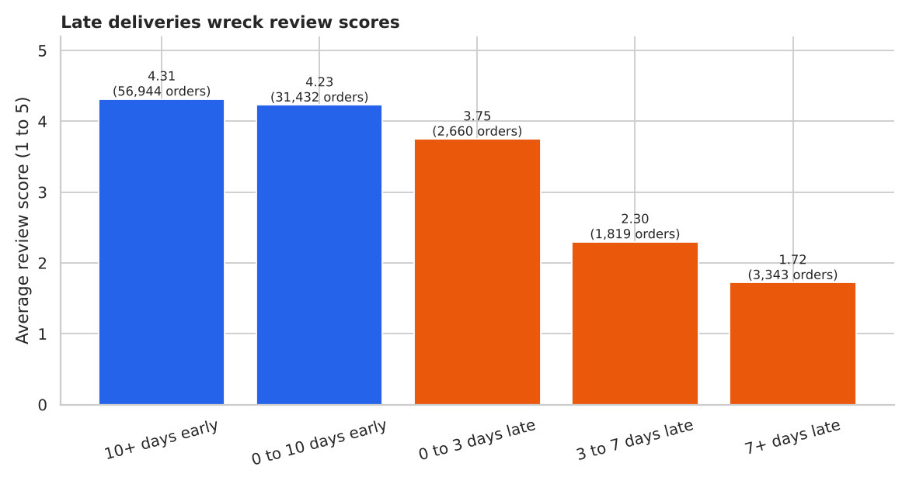
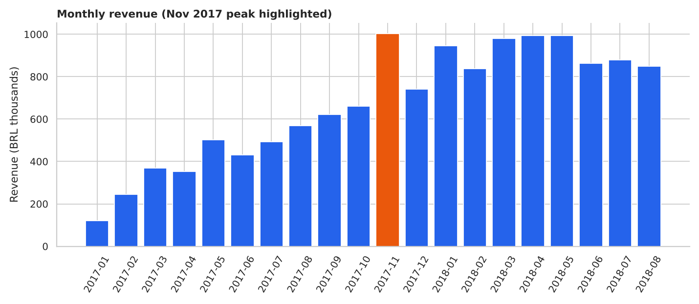
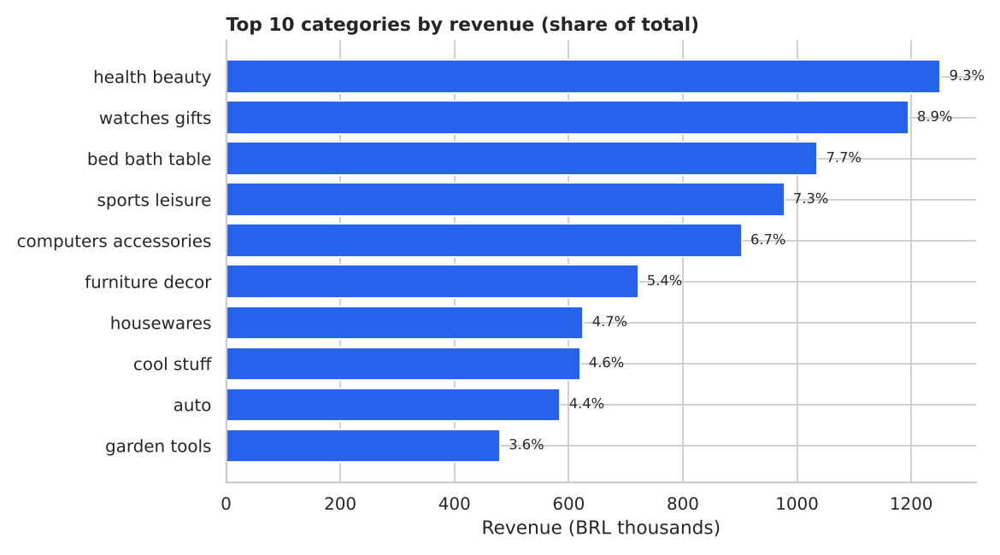
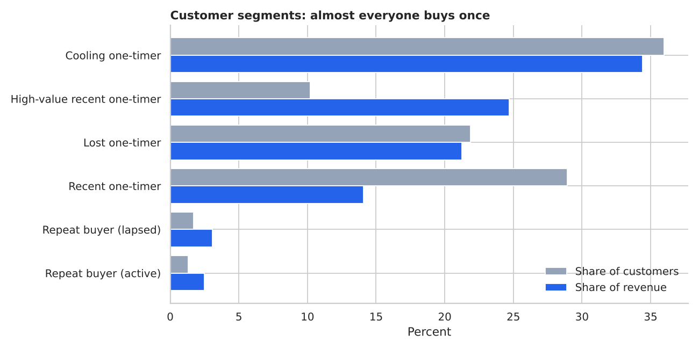
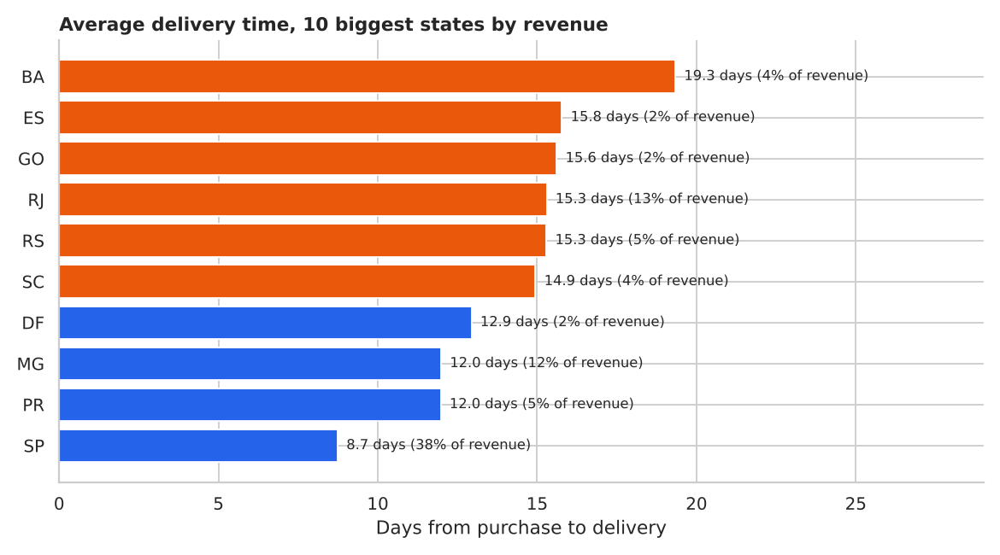

# Olist E-commerce Analytics: Sales, Customers and Delivery

Analysis of about 100,000 real orders from Olist, a Brazilian online marketplace (January 2017 to August 2018). The goal is to answer three business questions: where does revenue come from, do customers come back, and how much does late delivery cost in customer satisfaction.

**Stack:** Python, Pandas, SQL (SQLite), Matplotlib, Seaborn, Jupyter



## Key findings

| Metric | Result |
|---|---:|
| Valid orders | 97,910 |
| Unique customers | 94,707 |
| Revenue (item price, BRL) | 13.4M |
| Average order value | BRL 137 |
| Customers who ever bought twice | **3.0%** |
| Orders delivered after the estimated date | 8.1% |
| Average review, on-time orders | 4.28 |
| Average review, late orders | **2.55** |
| São Paulo share of revenue | 38% |
| Top 5 categories share of revenue | 40% |
| Top 10% of sellers share of revenue | 67% |

1. **The business depends on new customers.** Only 3% of customers buy a second time, and they bring just 5.6% of revenue. Month by month, 0.1% to 0.7% of a cohort returns, with no clear upward trend across cohorts.
2. **Late delivery is the biggest driver of bad reviews.** On-time orders average 4.28 stars. Late orders average 2.55, and 55% of them get 1 or 2 stars (9% for on-time orders). Even 0 to 3 days late costs half a star. Arriving early barely helps (4.31 vs 4.23), so the aim is to avoid lateness, not to be fastest.
3. **Delivery quality depends on the region.** São Paulo delivers in 8.7 days on average with 5.8% late. Rio de Janeiro, the second biggest market at 13% of revenue, takes 15.3 days with 13.1% late. Bahia and Ceará take 19 to 21 days.
4. **Revenue peaked in November 2017** at BRL 1.0M (Black Friday), 52% above October, then fell back in December. 2018 stayed between BRL 0.84M and 0.99M a month, so the spike did not become a new baseline.
5. **Revenue is spread across categories.** Health and beauty (9.3%), watches and gifts (8.9%) and bed, bath and table (7.7%) lead, and no category passes 10%. Electronics and furniture carry the heaviest freight, at 24% to 30% of the item price.
6. **Sellers are concentrated.** The top 10% of 3,029 sellers bring in 67% of revenue, so losing a few large sellers would hurt.

<p>


</p>
<p>


</p>

## Recommendations

1. **Fix lateness before chasing speed.** Show realistic delivery dates in slow regions, and flag orders that are about to miss their date so support can contact the customer before the review is written.
2. **Start with Rio de Janeiro.** It is the second biggest market and has more than double São Paulo's late rate.
3. **Run a second-purchase offer for high-value one-time buyers.** This group is 10% of customers but 25% of revenue (average spend BRL 343 against BRL 69 for other recent buyers).
4. **Review freight pricing on electronics and furniture**, where shipping is a quarter or more of the item price.
5. **Track seller concentration**, and build a plan for the case where a top seller leaves.

## Customer segments

Almost everyone has a single order, so classic RFM scoring is not useful here. Customers are grouped by order count, recency (at 31 August 2018) and spend instead.

| Segment | Customers | Revenue |
|---|---:|---:|
| Cooling one-timer (181 to 365 days since purchase) | 36% | 34% |
| High-value recent one-timer (top quarter by spend) | 10% | 25% |
| Lost one-timer (over 365 days) | 22% | 21% |
| Recent one-timer | 29% | 14% |
| Repeat buyer (lapsed) | 1.7% | 3.1% |
| Repeat buyer (active) | 1.3% | 2.5% |

## How I handled the data

- `customer_id` in the raw data is created per order, so counting it would treat every order as a new customer. All customer analysis uses `customer_unique_id` (95,774 real customers in the window, not 99,000).
- Orders with several reviews keep the most recent one.
- Only January 2017 to August 2018 is used. Late 2016 has almost no orders and September to October 2018 is cut off.
- Canceled and unavailable orders are excluded from revenue. Revenue means item price; freight is tracked separately.
- Category names are translated to English with Olist's translation table. Products without a category are labelled `unknown`.

## Project structure

```text
olist-ecommerce-analytics/
├── data/
│   └── README.md               # how to get the dataset (raw files are not committed)
├── scripts/
│   ├── prepare_data.py         # clean and join tables, build SQLite database
│   ├── run_analysis.py         # KPI tables and summary.json
│   ├── make_charts.py          # PNG charts
│   ├── run_sql.py              # run every query in sql/
│   └── build_notebooks.py      # generate the notebooks
├── sql/analysis_queries.sql    # 9 queries (window functions, CTEs, aggregation)
├── notebooks/                  # four executed notebooks with outputs
├── outputs/                    # result tables, summary.json, charts
└── requirements.txt
```

## How to run

1. Download the dataset as described in [data/README.md](data/README.md).
2. From the project root:

```bash
python -m pip install -r requirements.txt
cd scripts
python prepare_data.py
python run_analysis.py
python make_charts.py
python run_sql.py
```

3. Open the notebooks with `jupyter notebook notebooks`.

## SQL

[`sql/analysis_queries.sql`](sql/analysis_queries.sql) covers headline KPIs, month-on-month growth with `LAG`, category share of revenue, order count per customer, on-time vs late reviews, state delivery performance, payment mix, seller concentration and freight burden by category. The SQL results match the Python results (for example 3.04% repeat customers in both).

## Limitations

- The review gap between late and on-time orders shows a strong link, but it is not proof that lateness alone causes the low scores. Late orders may also differ in product, seller or region.
- The data ends in August 2018, so it says nothing about the market today.
- Revenue uses item price and leaves out freight and marketplace fees, so it is not Olist's own income.
- 3% repeat rate may partly reflect the data: customers who return under a new account would count as new.

## Data credit

Brazilian E-Commerce Public Dataset by Olist, released on Kaggle under CC BY-NC-SA 4.0. The data is anonymised. This project is for learning and portfolio use only.
